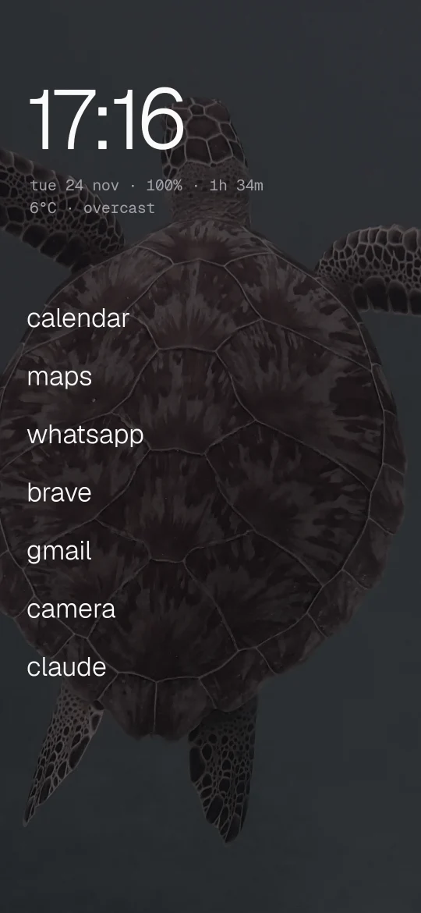
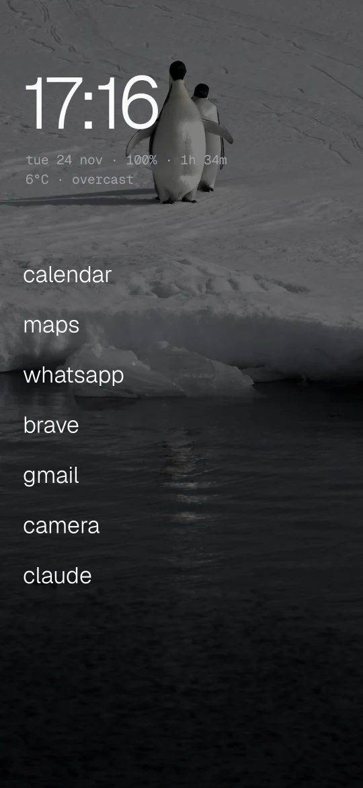
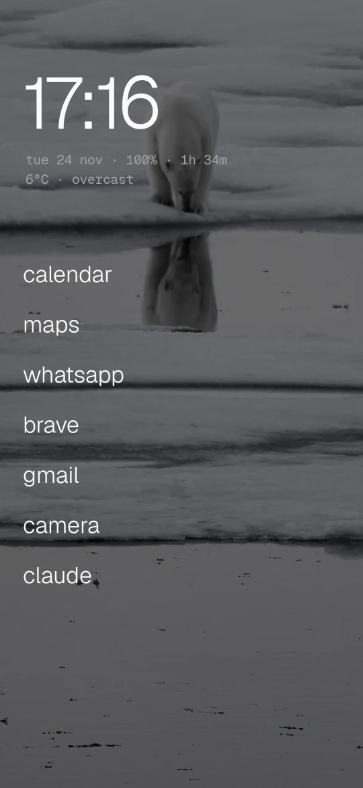
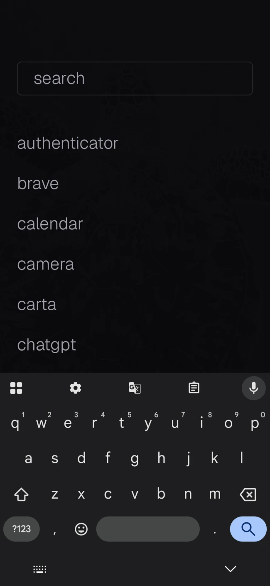
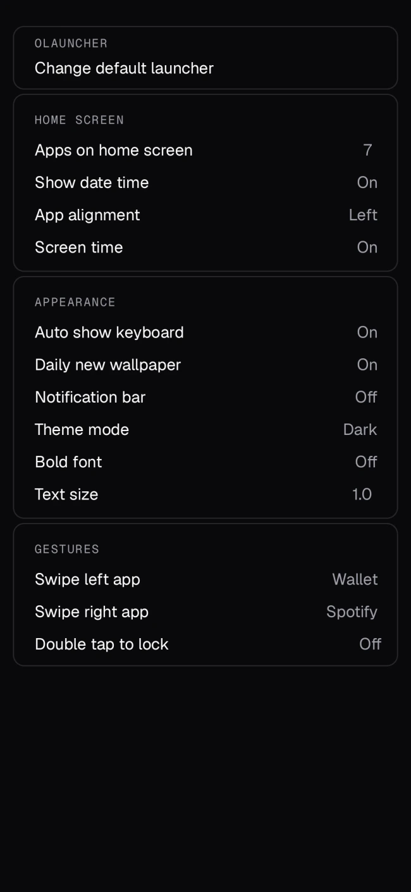

# phone

A personal fork of [Olauncher](https://github.com/tanujnotes/Olauncher) by [Tanuj](https://github.com/tanujnotes), customised for a Samsung Galaxy S22.

- Lowercase app names, Geist typography and a dark zinc palette across the home screen, app drawer and settings. Promotional rows and rating prompts are removed.
- The clock sits above a single line for the date, battery and screen time. A second line shows the local temperature and conditions using approximate foreground location and [Open-Meteo](https://open-meteo.com/).
- A shuffled collection of 87 animal and landscape photographs supplies a daily wallpaper for the home and lock screens. The images are bundled for offline use and toned down to keep text legible.

## Which phones can use it?

The minimum is **Android 7.0 (Nougat, API 24)** on a phone that lets you choose a default Home app. The fork has been tested on a **Samsung Galaxy S22 running Android 16 and One UI 8**. Other Android models that meet those requirements should be able to run it, but have not been verified here. This is an Android launcher and cannot be installed on an iPhone.

## On the S22

<p>
  
  
  
</p>

Captured on the handset. Green sea turtle photograph by [nbasargin](https://www.inaturalist.org/observations/335058941) ([CC BY 4.0](https://creativecommons.org/licenses/by/4.0/)). The [emperor penguin](https://www.inaturalist.org/observations/200575498) and [polar bear](https://www.inaturalist.org/observations/177564977) photographs are [CC0](https://creativecommons.org/publicdomain/zero/1.0/). The launcher crops, darkens and desaturates the photos.

Seven left-aligned shortcuts run from Calendar to Maps, WhatsApp, Brave, Gmail, Camera and Claude. Swipe left for Wallet or right for Spotify. The handset pairs the launcher with a custom ZincClear quick panel, gesture navigation and a dark, borderless keyboard. These are device settings.

## App drawer and settings

Swipe **up** on the home screen to search all apps. Swiping down opens the notification shade. Long-press an empty area of the home screen to change shortcuts, gestures, wallpaper and appearance.

<p>
  
  
</p>

## Try it

With JDK 17, Android SDK Platform 36 and a USB-debugging-enabled phone connected, run the following command from the repository root.

```sh
./gradlew installDebug
```

Choose Olauncher as the default Home app in Android settings. Enable **Daily new wallpaper** in launcher settings for the offline rotation. Allow approximate location for local weather. If location is unavailable, the weather line stays hidden.

## Credits

[Olauncher and fork licence (GPLv3)](LICENSE) · [Geist font licence](GEIST_LICENSE.txt) · [Wallpaper sources](app/src/main/res/raw/wallpapers.txt) · [Photo credits](app/src/main/assets/wallpapers/credits.txt)
